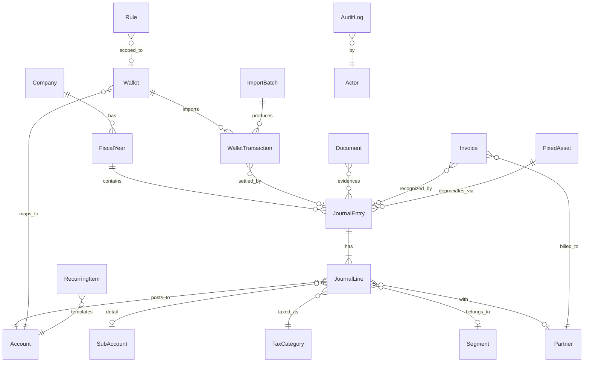

# 01. ドメインモデル

台帳（仕訳）を中心に、口座・明細・証憑・請求書・固定資産がぶら下がる構造です。残高・レポートはすべて仕訳から導出し、別に保持しません。金額は JPY の整数（bigint）で、小数は使いません。

## 1. 設定系

### Company（事業所）

1 行だけ。会社の実データ（法人番号・住所・登録番号）は DB に置き、リポジトリには置かない。

| 項目 | 型 | 備考 |
| --- | --- | --- |
| name / nameKana | string | 商号 |
| corporateNumber | string? | 法人番号（13 桁） |
| invoiceRegistrationNumber | string? | T + 13 桁。登録したら設定。請求書に印字 |
| address, representative | string | 請求書・決算書に印字 |
| fiscalYearStartMonth | int | 4 |
| bankAccountForInvoice | json? | 請求書に印字する振込先（v2） |

### FiscalYear（会計期間）

| 項目 | 型 | 備考 |
| --- | --- | --- |
| no | int | 第 n 期 |
| startDate / endDate | date | 第 1 期は設立日〜2027-03-31 |
| status | `open` / `closing` / `closed` | `closing` は決算整理中（通常仕訳は不可、決算整理仕訳のみ可） |
| consumptionTax | `exempt` / `general` / `simplified` | 免税 / 本則課税 / 簡易課税 |
| accountingMethod | `tax_inclusive` / `tax_exclusive` | 税込経理 / 税抜経理。免税の期は `tax_inclusive` 固定 |
| lockedThrough | date? | 月次の締め。この日以前への仕訳登録・訂正は不可 |

### Account（勘定科目）

標準テンプレート（[02 §2](02-accounting-rules.md)）から生成し、追加・無効化できる。コードは 4 桁で、1xxx 資産・2xxx 負債・3xxx 純資産・4xxx 収益・5xxx 費用・8xxx 決算整理/法人税等・9xxx 内部取引。

| 項目 | 型 | 備考 |
| --- | --- | --- |
| code | string | 4 桁。並び順にも使う |
| name | string | 表示名（例: 普通預金） |
| kind | `asset` / `liability` / `equity` / `revenue` / `expense` / `internal` | `internal` はセグメント間取引用で、会社全体では常に 0 |
| group | enum | 決算書の表示区分（流動資産 / 固定資産 / 繰延資産 / 流動負債 / 固定負債 / 株主資本 / 売上高 / 売上原価 / 販管費 / 営業外収益 / 営業外費用 / 特別利益 / 特別損失 / 法人税等） |
| defaultTaxCategoryCode | string? | この科目を使ったときの既定の税区分 |
| isCashLike | bool | 現預金レポートの対象（現金・預金・Stripe 残高） |
| eTaxCode / eTaxHierarchy / eTaxRowKind | string? / int? / string? | e-Tax 財務諸表 CSV（HOT010）の勘定科目コード・階層番号・行区分。公式のコード表から版管理つきで取り込む（v2） |
| isActive, sortOrder, note | | |

### SubAccount（補助科目）

勘定科目の内訳。口座と 1 対 1 のもの（普通預金 / GMO あおぞら、Stripe 残高 / platform）と、取引先別のもの（売掛金 / 取引先 A）がある。

### TaxCategory（税区分）

税区分は「申告書の集計区分」としてコードで固定し、税率・控除割合・適用期間は `TaxRateRule`（税区分コード・effectiveFrom / effectiveTo・rate・deductibleRatio）で別に持つ。経過措置や税率の改定はデータの追加だけで済む。

| 項目 | 型 | 備考 |
| --- | --- | --- |
| code | string | 例: `sales_10`, `sales_8r`, `sales_exempt`, `sales_out`, `purchase_10`, `purchase_8r`, `purchase_10_ni`（インボイスなし。控除割合は日付で決まる）, `purchase_exempt`, `purchase_out`, `na`（対象外） |
| direction | `sales` / `purchase` / `none` | |
| kind | `taxable` / `exempt` / `out_of_scope` / `export` / `na` | 課税 / 非課税 / 不課税 / 輸出免税 / 対象外 |

税率と控除割合は `TaxRateRule`（taxCategoryCode・effectiveFrom / effectiveTo・ratePercent・deductiblePercent・enabled）に持つ。インボイスなしの仕入は経過措置で 80%（〜2026-09-30）→ 70%（2026-10-01〜2028-09-30）→ 50%（〜2030-09-30）→ 30%（〜2031-09-30）→ 0%。期間が重なる行は開始が遅いものを優先する（飲食料品 1% は `enabled: false` の行として置き、成立したら有効にする）。

### Segment（セグメント）

`platform` / `kamakura` / `contract` / `corporate`（共通）。拠点が増えたら行を足す。仕訳行ごとに 1 つ。

### Partner（取引先）

| 項目 | 型 | 備考 |
| --- | --- | --- |
| name, nameKana | string | |
| kind | `customer` / `vendor` / `both` / `other` | |
| invoiceRegistrationNumber | string? | 相手の登録番号（T + 13 桁） |
| invoiceRegistrationStatus | `unknown` / `verified` / `not_found` / `revoked` | 国税庁 API の照合結果と日時（v2） |
| defaultAccountId, defaultSegmentId, defaultTaxCategoryCode | | 明細の推定に使う |
| email, address, note, isActive | | 請求書の宛先（v2） |

### MemoTag

自由なタグ（例: `出張`, `kamakura 改装`）。仕訳行に複数。

## 2. 口座と明細

### Wallet（口座）

| 項目 | 型 | 備考 |
| --- | --- | --- |
| name | string | 表示名（例: GMO あおぞら 法人, 三井住友カード, Stripe platform, 現金, 役員立替） |
| kind | `bank` / `card` / `cash` / `stripe` / `owner` / `other` | `owner` は役員の立替・借入 |
| accountId / subAccountId | | 紐づく勘定科目。bank→普通預金、card→未払金、cash→現金、stripe→Stripe 残高（資産）、owner→役員借入金 |
| importer | string? | CSV 形式のキー（例: `gmo_aozora_csv`）、`stripe`、銀行 API のキー |
| defaultSegmentId | | 拠点の Stripe アカウントは ②、platform は ① |
| openingBalanceDate / openingBalance | | その日の明細の残高。取込の照合の起点（S4）で、仕訳にはせず帳簿の残高にも足さない。設立と同時に帳簿を始める会社では空欄 |
| isActive | | |

Stripe の口座は `StripeAccountLink`（stripeAccountId、Secret Manager 上のキー名、同期カーソル、最終同期日時）を 1 対 1 で持つ。アカウント ID は DB にだけ置く。

### WalletTransaction（明細）

口座から取り込んだ 1 行。取り込んだ明細は削除せず、「無視」で処理済みにする（freee と同じ）。

| 項目 | 型 | 備考 |
| --- | --- | --- |
| walletId, txnDate | | |
| amount | bigint | 符号付き。口座から見て入金が正 |
| descriptionRaw | string | 明細の摘要そのまま |
| counterpartyRaw | string? | 振込人名など |
| balanceAfter | bigint? | 残高が取れる形式のときだけ。残高照合に使う |
| externalId | string | 口座内で一意。CSV は `日付+金額+摘要+行番号` のハッシュ、Stripe は balance transaction ID |
| importBatchId | | |
| status | `pending` / `registered` / `transfer` / `ignored` | 未処理 / 登録済み / 口座間の振替 / 無視 |
| journalEntryId | | 登録・振替で作られた仕訳 |
| suggestion | json | 推定した科目・税区分・取引先・セグメント・ルール ID・信頼度 |
| ignoredReason | string? | |

重複の排除は `(walletId, externalId)` の一意制約。同じファイルの再取込は `ImportBatch.fileSha256` で弾く。

### ImportBatch（取込）

`source`（csv / stripe / api）、取り込んだファイルの証憑 ID と SHA-256、行数・取込数・重複数・失敗数、実行者、日時。

### Rule（自動登録ルール）

| 項目 | 型 | 備考 |
| --- | --- | --- |
| walletId | | null なら全口座 |
| match | json | `descriptionContains` / `descriptionRegex` / `amountMin` / `amountMax` / `sign` / `counterpartyContains` |
| action | json | `mode`: `register` / `transfer` / `ignore` / `suggest`。`accountId`, `taxCategoryCode`, `partnerId`, `segmentId`, `descriptionTemplate`, `transferToWalletId` |
| autoPost | bool | true なら取込時に自動で登録（未処理に出さない）。false なら候補として表示 |
| priority, hitCount, lastHitAt, isActive | | |

## 3. 台帳

### JournalEntry（仕訳）

| 項目 | 型 | 備考 |
| --- | --- | --- |
| no | int | 期ごとの連番。欠番を作らない |
| fiscalYearId, entryDate | | `entryDate` は期の範囲内かつ `lockedThrough` より後 |
| description | string | 摘要 |
| kind | `opening` / `normal` / `transfer` / `adjusting` / `closing` / `reversal` | 開始 / 通常 / 口座間振替 / 決算整理 / 決算振替 / 反対仕訳 |
| sourceKind | `manual` / `wallet_txn` / `stripe` / `invoice` / `fixed_asset` / `recurring` / `import` / `system` | 生成元 |
| sourceId | string? | 生成元の ID |
| status | `posted` / `voided` | 登録済み / 取消済み（反対仕訳で相殺済み） |
| reversalOfId / replacedById | | 訂正の連鎖。取消された仕訳 → 反対仕訳 → 新仕訳 |
| voidReason | string? | |
| createdBy, createdAt, postedAt | | |

不変条件:

- 行の借方合計 = 貸方合計。行は 2 本以上。各行の金額は正。
- `posted` になった仕訳は行を書き換えない。DB のトリガーでも `posted` 行の UPDATE / DELETE を禁止し、貸借一致は deferred constraint で commit 時に検証する。訂正は `voidEntry(reason)` が反対仕訳（`kind=reversal`）を同日付で作り、必要なら新しい仕訳を作って `replacedById` で結ぶ。締めた期間の仕訳を訂正するときは反対仕訳と新仕訳を開いている最初の日付で作る。
- `entryDate` が `FiscalYear.lockedThrough` 以前なら登録・取消とも拒否。`status=closed` の期は決算整理も不可。
- 行は仕訳ヘッダと同じトランザクションで、ヘッダの INSERT の直後にだけ追加できる（DB トリガー）。登録済みの仕訳に後から行を足すことはできない。一括取込も「ヘッダ → その行」の順で書く。
- 連番 `no` は `FiscalYear.nextEntryNo` を行ロックの下で `UPDATE ... RETURNING` して採る。DB が保証するのは一意だけで、欠番のなさはリポジトリ層（`postJournalEntry`）を通すことで守る。
- 連番 `no` は登録時に採番し、取消しても欠番にしない（取消は別の仕訳として連番を消費する）。

### JournalLine（仕訳行）

| 項目 | 型 | 備考 |
| --- | --- | --- |
| lineNo | int | |
| side | `debit` / `credit` | |
| accountId, subAccountId | | |
| amount | bigint | 税込（税込経理）または税抜（税抜経理）の計上額 |
| taxCategoryCode | string | 必須。対象外は `na` |
| taxAmount | bigint | 行に含まれる消費税額。税込経理でも集計のために保持 |
| segmentId | | 収益・費用の行は必須。BS 科目は任意 |
| partnerId, description, memoTagIds | | |

税抜経理の期は、登録時に `仮受消費税` / `仮払消費税` の行を自動で追加する。税込経理の期は追加せず `taxAmount` だけ保持する。

## 4. 証憑

### Document（証憑）

| 項目 | 型 | 備考 |
| --- | --- | --- |
| kind | `receipt` / `invoice_in` / `invoice_out` / `contract` / `statement` / `other` | 領収書 / 受領した請求書 / 発行した請求書の写し / 契約書 / 明細書 |
| storageKey, sha256, mime, byteSize, originalName | | GCS のオブジェクト。バージョニングと削除保護 |
| uploadedBy, uploadedAt, source | | `upload` / `camera` / `email` / `stripe` / `generated` |
| txnDate, amount, partnerId / partnerName, invoiceRegistrationNumber | | 検索要件の 3 項目（取引年月日・取引金額・取引先）。保存時に必須にはせず、「未整理」として検索で見つける |
| extraction | json? | 読み取り結果（日付・金額・税率別の内訳・登録番号・候補の科目）と確信度 |
| status | `inbox` / `linked` / `voided` | 未紐づけ / 紐づけ済み / 無効（誤アップロードなど。ファイルは残す） |
| supersedesId | | 差し替えは新しい行を作り、旧行を `voided` にして結ぶ |

`DocumentLink` で仕訳・明細・請求書に多対多で結ぶ。1 つの仕訳に複数の証憑、1 つの証憑に複数の仕訳（カード明細書など）を許す。

## 5. 請求（v2）

### Invoice（見積書・納品書・請求書）

| 項目 | 型 | 備考 |
| --- | --- | --- |
| docType | `quote` / `delivery` / `invoice` | 見積 → 納品 → 請求を「変換」で作る。変換元 ID を持つ |
| number | string | 種別・期ごとの連番（例: `INV-2026-0001`）。再発行でも番号は変えない |
| partnerId, issueDate, dueDate, title | | |
| lines | json | 品名・数量・単価・税率・税区分 |
| subtotalByRate, taxByRate, total | json / bigint | 税率ごとの対価の額と消費税額（適格請求書の記載事項）。端数は税率ごとに 1 回切り捨て |
| issuerSnapshot | json | 発行時の自社名・住所・登録番号・振込先 |
| status | `draft` / `issued` / `sent` / `paid` / `void` | |
| pdfDocumentId | | 発行した PDF は証憑（`invoice_out`）として保存 |
| journalEntryId | | 発行時に 売掛金 / 売上 を計上 |
| payments | json | 入金の消込（明細 ID・日付・金額） |
| stripePaymentLinkUrl | string? | Stripe で受けるときだけ |

## 6. 固定資産（v2）

### FixedAsset

| 項目 | 型 | 備考 |
| --- | --- | --- |
| name, accountId（建物附属設備 / 工具器具備品 / ソフトウェア など） | | |
| acquisitionDate, cost | | 取得日・取得価額 |
| method | `straight_line` / `declining_balance` / `immediate` / `lump_sum_3y` | 定額 / 定率 / 即時償却（10 万円未満、または中小企業者の特例: 2026-04-01 以後は 40 万円未満） / 一括償却（3 年）。特例は年 300 万円（月割）の累計と青色申告の有無を検査し、償却資産税の対象フラグを持つ |
| usefulLifeYears, residualRule | | 耐用年数、備忘価額 1 円 |
| schedule | json | 期ごとの償却額。決算整理仕訳の生成元 |
| disposedAt, disposalEntryId | | 除却・売却 |

## 7. 予定と暦

### RecurringItem（定期取引）

家賃・サブスク・税金・役員報酬など、毎月/毎年決まって起きる取引。資金繰り予測の入力であり、明細の推定（同額・同周期）にも使う。

### CalendarItem（期限）

税務・法務の期限（申告、納付、届出、株主総会）。会計期間から規則で生成し、完了を記録する。[07](07-operations.md) の年間スケジュールが元。

## 8. 監査と権限

### AuditLog

すべての作成・更新・取消・ログイン・エクスポートを `at, actor, action, entity, entityId, before, after, reason` で残す。電子帳簿保存法の「訂正・削除の履歴」として扱うため、アプリからは追記のみ（DB ロールにも UPDATE/DELETE を与えない）。

### Actor / User

v1 は 1 ユーザー（IAP で認証した Google アカウントのメール）。v3 で役割（`owner` / `accountant` / `viewer`）を足す。

## 9. ID と日付

- ID は ULID（時系列で並ぶ）。外部に見せる番号は `JournalEntry.no` と `Invoice.number`。
- 日付は `date`（JST の暦日）。タイムスタンプは UTC。会計上の日付に時刻を持たせない。
